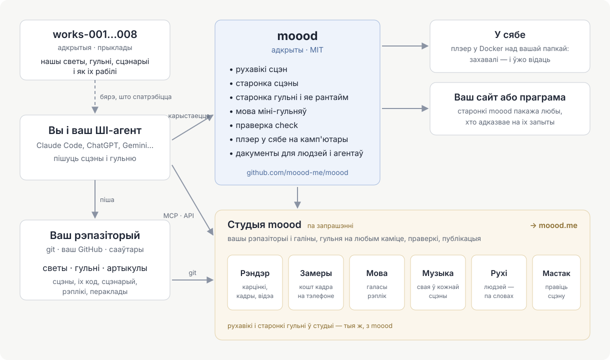

[English](README.md) · [Русский](README.ru.md) · [Українська](README.uk.md) · [Deutsch](README.de.md) · [Español](README.es.md) · [日本語](README.ja.md) · Беларуская · [Français](README.fr.md) · [繁體中文](README.zh-hant.md) · [Português (Brasil)](README.pt.md) · [Polski](README.pl.md) · [한국어](README.ko.md)

# moood

[moood](https://moood.me) — гэта жывыя анімаваныя светы і гульні, у якія на іх гуляюць. **Свет** — набор сцэн: месцаў са
сваім настроем, намаляваных кодам, са святлом і рухам; **гульня** — гісторыя, якая разгортваецца ў свеце і якую аўтар
піша ўласным кодам (гульня *bespoke*): раздзелы, выбары, агучаныя рэплікі, міні-гульні.

Гэта адкрытая частка moood: рухавікі, што запускаюць сцэны, рантайм, што прайгравае гульню, мова міні-гульняў, `check`
для тэкстаў і перакладаў, лакальны прайгравальнік — і дакументацыя для тых, хто стварае светы і гульні. Пішыце свае; мы
будзем рады ўбачыць іх на moood.

## Стварэнне светаў і гульняў

Вашы светы і гульні жывуць у вашым уласным git-рэпазіторыі — у любой колькасці і ў любых папках: папка з `world.json` —
гэта свет, з `game.json` — гульня, з `article.json` — артыкул (для сайта moood: лакальны прайгравальнік паказвае светы
і гульні). Працуйце, як вам зручна:

- **На сваім камп'ютары** — запусціце лакальны прайгравальнік над сваім рэпазіторыем і гуляйце ў тое, што ствараеце,
  адразу пасля захавання ([player/README.md](player/README.md)).
- **У студыі** — `studio.moood.me` (будуецца): ваш профіль, вашы рэпазіторыі, рэндэры, галасы, музыка і рухі, зробленыя
  для вас. Доступ: папрасіце [pavel-zhur](https://github.com/pavel-zhur) — completely.real@gmail.com.
- **З ШІ-агентам** — Claude Code, ChatGPT, Gemini або любым іншым, на вашай машыне ці ў воблачнай сесіі: пакажыце
  яму [docs/](docs/README.md) — яны напісаны як для агентаў, так і для людзей.

Каб гульню апублікавалі на moood.me, папрасіце ў студыі; перад паказам яе правяраюць.

## Змены ў moood

Прасіце праз GitHub issues у гэтым рэпазіторыі (`AGENTS.md`).

## Дакументацыя

[docs/README.md](docs/README.md) — з чаго пачаць: прынцыпы, мова сцэны, людзі і рух, як будуецца гульня, міні-гульні, як
пісаць гісторыю гульні. Большая частка пакуль па-руску; англійская будзе.

## Структура

- `engines/1/` — рухавік 1 (карціны ў Canvas 2D, малюе three.js на WebGL2) і сцэна, на якой кожная старонка паказвае сцэну (`stage.js`: любы з двух рухавікоў
  за адзіным API; маўленне, музыка, подпісы, віджэты, гучнасць); яго старонкі для рэндарэраў (`render.html`, `stand.html`,
  `motion.html`); даныя пра людзей, якія чытаюць абодва рухавікі.
- `engines/3/` — рухавік 3 (WebGPU): сцэна з `"engine": 3` — кожная новая сцэна.
- `scene/` — старонка сцэны; `host.js` — бок старонак у зносінах з хостам.
- `play/` — старонка bespoke-партыі, яе рантайм (`runtime.js`: што атрымлівае код гульні) і мова міні-гульняў
  (`minigame/`).
- `i18n/` — мовы (`languages.json`), перакладчык, праз якога ідзе кожны тэкст (`i18n.js`), словы старонак.
- `packages/check/` — `@moood/check`: праверка рэпазіторыя светаў, гульняў і артыкулаў.
- `player/` — лакальны прайгравальнік: светы і гульні папкі, паказаныя і згуляныя старонкамі (`Dockerfile` — яго вобраз).
- `test/` — тэсты (`node --test test/*.test.js`, калі сабраны `packages/check`: там `npm ci && npm run build`)
  і іх фікстура; `test/gpu/` — праверка GPU-праграм рухавіка 3 у node (там `npm ci && node check.mjs`);
  `.github/workflows/ci.yml` — check, тэсты і праверка GPU на кожны push і pull request; з `main` — вобраз прайгравальніка, `ghcr.io/moood-me/moood-player`; з тэга
  `check-v<version>` — `@moood/check` у npm (trusted publishing ад npm: пакет давярае `ci.yml` гэтага рэпазіторыя; без токена).
- `docs/host.md` — чаго старонкі патрабуюць ад таго, хто іх абслугоўвае; `docs/engine3/` — уласныя дакументы рухавіка 3
  (яго ўладкаванне, кантракты, план: для тых, хто яго змяняе); `docs/history/` — што зроблена і як.

Студыі, публічнага сайта і таго, што робіць галасы, музыку, выявы і рухі (майстэрні), тут няма; старонкі просяць гэта ў
свайго хоста, а хост, які нічога з гэтага не робіць, — лакальны прайгравальнік — бярэ гатовае ў майстэрні студыі па
ключы (`docs/host.md`: The workshop).

## Ліцэнзія

MIT (`LICENSE`). Чужое ўнутры — пад сваімі ліцэнзіямі: three.js (MIT, яго паведамленне ў пачатку
`engines/1/three.js`), целы і адзенне (`engines/1/bodies/bodies.md`), SOMA (`engines/1/soma.md`) — іх часткі пад
Apache-2.0 названы ў `engines/1/NOTICE`, ліцэнзія побач (`engines/1/LICENSE-Apache-2.0.txt`) —, гукі
міні-гульняў (`play/minigame/sounds/LICENSE.md`).
