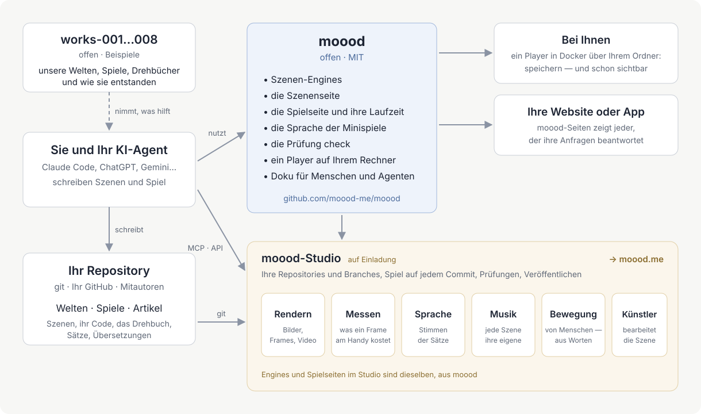

[English](README.md) · [Русский](README.ru.md) · [Українська](README.uk.md) · Deutsch · [Español](README.es.md) · [日本語](README.ja.md) · [Беларуская](README.be.md) · [Français](README.fr.md) · [繁體中文](README.zh-hant.md) · [Português (Brasil)](README.pt.md) · [Polski](README.pl.md) · [한국어](README.ko.md)

# moood

[moood](https://moood.me) sind lebendige, animierte Welten und die Spiele, die auf ihnen gespielt werden. Eine **Welt**
ist eine Reihe von Szenen — Orte mit ihrer Stimmung, in Code gemalt, beleuchtet und bewegt; ein **Spiel** ist eine
Geschichte, die auf einer Welt gespielt wird und die ihr Autor als eigenen Code schreibt (ein *bespoke*-Spiel): Kapitel,
Entscheidungen, vertonte Zeilen, Minispiele.

Dieses Repository ist der offene Teil von moood: die Engines, die Szenen abspielen, die Laufzeit, die ein Spiel
ausführt, die Sprache der Minispiele, `check` für Texte und Übersetzungen, ein lokaler Player — und die Dokumentation
für alle, die Welten und Spiele machen. Schreibe deine eigenen; wir würden uns freuen, sie auf moood zu sehen.

## Welten und Spiele machen

Deine Welten und Spiele liegen in deinem eigenen Git-Repository — beliebig viele, in beliebigen Ordnern: Ein Ordner mit
`world.json` ist eine Welt, mit `game.json` ein Spiel, mit `article.json` ein Artikel (für die Seite von moood: Der
lokale Player zeigt Welten und Spiele). Arbeite so, wie es dir gefällt:

- **Auf deinem Computer** — starte den lokalen Player über deinem Repository und spiele, was du machst, sobald du es
  speicherst ([player/README.md](player/README.md)).
- **Im Studio** — `studio.moood.me` (im Aufbau): dein Profil, deine Repositories, Renderings, Stimmen, Musik und
  Bewegungen, die für dich gemacht werden. Zugang: Frag [pavel-zhur](https://github.com/pavel-zhur) — completely.real@gmail.com.
- **Mit einem KI-Agenten** — Claude Code, ChatGPT, Gemini oder jedem anderen, auf deinem Rechner oder in einer
  Cloud-Sitzung: Verweise ihn auf [docs/](docs/README.md) — die Dokumentation ist ebenso für Agenten wie für Menschen
  geschrieben.

Damit ein Spiel auf moood.me veröffentlicht wird, bitte im Studio darum; es wird geprüft, bevor es gezeigt wird.

## Änderungen an moood

Bitte über GitHub-Issues in diesem Repository (`AGENTS.md`).

## Dokumentation

[docs/README.md](docs/README.md) — wo du anfängst: Prinzipien, die Sprache der Szene, Menschen und Bewegung, wie ein
Spiel aufgebaut ist, Minispiele, wie man die Geschichte eines Spiels schreibt. Das meiste ist vorerst auf Russisch;
Englisch folgt.

## Aufbau

- `engines/1/` — Engine 1 (Gemälde in Canvas 2D, von three.js auf WebGL2 gezeichnet) und die Bühne, auf der jede Seite eine Szene zeigt (`stage.js`: beide Engines
  hinter einer API; Sprache, Musik, Untertitel, Widgets, Lautstärke); ihre Seiten für Renderer (`render.html`, `stand.html`,
  `motion.html`); die Daten der Menschen, die beide Engines lesen.
- `engines/3/` — Engine 3 (WebGPU): eine Szene mit `"engine": 3` — jede neue Szene.
- `scene/` — die Seite der Szene; `host.js` — die Seite der Seiten im Austausch mit dem Host.
- `play/` — die Seite des bespoke-Spiels, seine Laufzeit (`runtime.js`: was der Code eines Spiels bekommt) und die
  Sprache der Minispiele (`minigame/`).
- `i18n/` — die Sprachen (`languages.json`), der Übersetzer, durch den jeder Text läuft (`i18n.js`), die Wörter der Seiten.
- `packages/check/` — `@moood/check`: ein Repository aus Welten, Spielen und Artikeln, geprüft.
- `player/` — der lokale Player: die Welten und Spiele eines Ordners, von den Seiten gezeigt und gespielt (`Dockerfile` — sein Image).
- `test/` — die Tests (`node --test test/*.test.js`, sobald `packages/check` gebaut ist: dort `npm ci && npm run build`)
  und ihre Fixture; `test/gpu/` — die GPU-Programme von Engine 3, in node geprüft (dort `npm ci && node check.mjs`);
  `.github/workflows/ci.yml` — check, die Tests und die GPU-Prüfung bei jedem Push und Pull Request; aus `main` das Image des Players, `ghcr.io/moood-me/moood-player`; aus einem Tag
  `check-v<version>` `@moood/check` auf npm (Trusted Publishing von npm: Das Paket vertraut der `ci.yml` dieses Repositorys; kein Token).
- `docs/host.md` — was die Seiten von dem verlangen, der sie ausliefert; `docs/engine3/` — die eigenen Dokumente von
  Engine 3 (ihr Entwurf, Verträge, Plan: für alle, die sie ändern); `docs/history/` — was getan wurde und wie.

Das Studio, die öffentliche Seite und das, was Stimmen, Musik, Bilder und Bewegungen macht (die Werkstatt), sind nicht
hier; die Seiten fragen ihren Host danach, und ein Host, der nichts davon macht — der lokale Player —, bezieht
Fertiges per Schlüssel aus der Werkstatt eines Studios (`docs/host.md`: The workshop).

## Lizenz

MIT (`LICENSE`). Werke Dritter darin behalten ihre eigene Lizenz: three.js (MIT, sein Hinweis am Anfang von
`engines/1/three.js`), die Körper und Kleider (`engines/1/bodies/bodies.md`), SOMA (`engines/1/soma.md`) — die
Apache-2.0-Teile davon in `engines/1/NOTICE`, die Lizenz daneben (`engines/1/LICENSE-Apache-2.0.txt`) —, die Klänge
der Minispiele (`play/minigame/sounds/LICENSE.md`).
