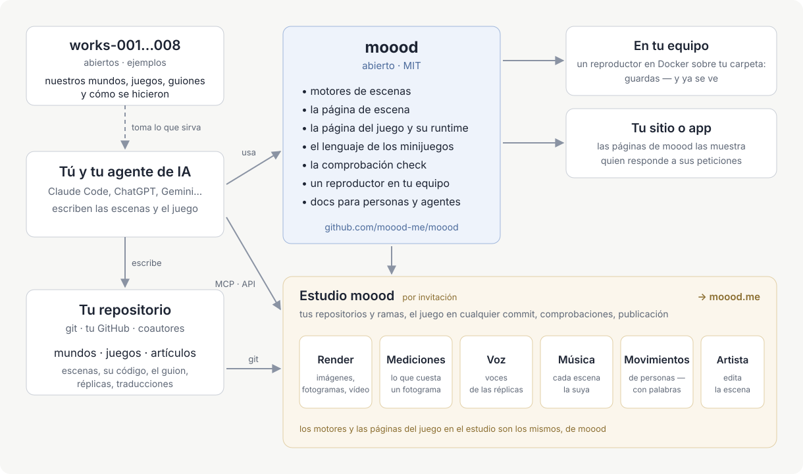

[English](README.md) · [Русский](README.ru.md) · [Українська](README.uk.md) · [Deutsch](README.de.md) · Español · [日本語](README.ja.md) · [Беларуская](README.be.md) · [Français](README.fr.md) · [繁體中文](README.zh-hant.md) · [Português (Brasil)](README.pt.md) · [Polski](README.pl.md) · [한국어](README.ko.md)

# moood

[moood](https://moood.me) son mundos vivos y animados y los juegos que se juegan en ellos. Un **mundo** es un conjunto
de escenas: lugares con su ambiente, pintados en código, iluminados y en movimiento; un **juego** es una historia
jugada en un mundo, que su autor escribe como código propio (un juego *bespoke*): capítulos, elecciones, líneas con voz,
minijuegos.

Este repositorio es la parte abierta de moood: los motores que ejecutan las escenas, el runtime que reproduce un juego,
el lenguaje de los minijuegos, `check` para textos y traducciones, un reproductor local — y la documentación para
quienes crean mundos y juegos. Escribe los tuyos; nos alegrará verlos en moood.

## Crear mundos y juegos

Tus mundos y juegos viven en tu propio repositorio git — los que quieras, en las carpetas que quieras: una carpeta con
`world.json` es un mundo, con `game.json` un juego, con `article.json` un artículo (para el sitio de moood: el
reproductor local muestra mundos y juegos). Trabaja como prefieras:

- **En tu ordenador** — ejecuta el reproductor local sobre tu repositorio y juega lo que haces en cuanto lo guardas
  ([player/README.md](player/README.md)).
- **En el estudio** — `studio.moood.me` (en construcción): tu perfil, tus repositorios, renders, voces, música y
  movimientos hechos para ti. Acceso: pídelo a [pavel-zhur](https://github.com/pavel-zhur) — completely.real@gmail.com.
- **Con un agente de IA** — Claude Code, ChatGPT, Gemini o cualquier otro, en tu máquina o en una sesión en la nube:
  indícale [docs/](docs/README.md) — está escrita tanto para agentes como para personas.

Para que un juego se publique en moood.me, pídelo en el estudio; se revisa antes de mostrarse.

## Cambios en moood

Pídelos mediante los issues de GitHub de este repositorio (`AGENTS.md`).

## Documentación

[docs/README.md](docs/README.md) — por dónde empezar: principios, el lenguaje de la escena, personas y movimiento, cómo
se construye un juego, minijuegos, cómo escribir la historia de un juego. La mayor parte está en ruso por ahora; el
inglés llegará.

## Estructura

- `engines/1/` — motor 1 (pinturas en Canvas 2D, dibujadas por three.js sobre WebGL2) y el escenario en el que cada página muestra una escena (`stage.js`: cualquiera de los dos motores
  tras una sola API; voz, música, subtítulos, widgets, volumen); sus páginas para renderizadores (`render.html`, `stand.html`,
  `motion.html`); los datos de las personas que leen ambos motores.
- `engines/3/` — motor 3 (WebGPU): una escena con `"engine": 3` — toda escena nueva.
- `scene/` — la página de la escena; `host.js` — el lado de las páginas en el trato con el host.
- `play/` — la página de la partida bespoke, su runtime (`runtime.js`: lo que recibe el código de un juego) y el
  lenguaje de los minijuegos (`minigame/`).
- `i18n/` — los idiomas (`languages.json`), el traductor por el que pasa cada texto (`i18n.js`), las palabras de las páginas.
- `packages/check/` — `@moood/check`: un repositorio de mundos, juegos y artículos, comprobado.
- `player/` — el reproductor local: los mundos y juegos de una carpeta, mostrados y jugados por las páginas (`Dockerfile` — su imagen).
- `test/` — las pruebas (`node --test test/*.test.js`, una vez compilado `packages/check`: allí `npm ci && npm run build`)
  y su fixture; `test/gpu/` — los programas de GPU del motor 3 comprobados en node (allí `npm ci && node check.mjs`);
  `.github/workflows/ci.yml` — check, las pruebas y la comprobación de GPU en cada push y pull request; desde `main` la imagen del reproductor, `ghcr.io/moood-me/moood-player`; desde una etiqueta
  `check-v<version>` `@moood/check` en npm (trusted publishing de npm: el paquete confía en el `ci.yml` de este repositorio; sin token).
- `docs/host.md` — lo que las páginas piden a quien las sirve; `docs/engine3/` — los documentos propios del motor 3 (su
  diseño, contratos, plan: para quien lo cambia); `docs/history/` — qué se hizo y cómo.

El estudio, el sitio público y lo que hace las voces, la música, las imágenes y los movimientos (el taller) no están
aquí; las páginas se lo piden a su host, y un host que no hace nada de eso — el reproductor local — toma lo ya hecho
del taller de un estudio mediante una clave (`docs/host.md`: The workshop).

## Licencia

MIT (`LICENSE`). Lo de terceros incluido conserva su propia licencia: three.js (MIT, su aviso al principio de
`engines/1/three.js`), los cuerpos y la ropa (`engines/1/bodies/bodies.md`), SOMA (`engines/1/soma.md`) — las partes
de ellos con Apache-2.0 en `engines/1/NOTICE`, la licencia a su lado (`engines/1/LICENSE-Apache-2.0.txt`) —, los
sonidos de los minijuegos (`play/minigame/sounds/LICENSE.md`).
