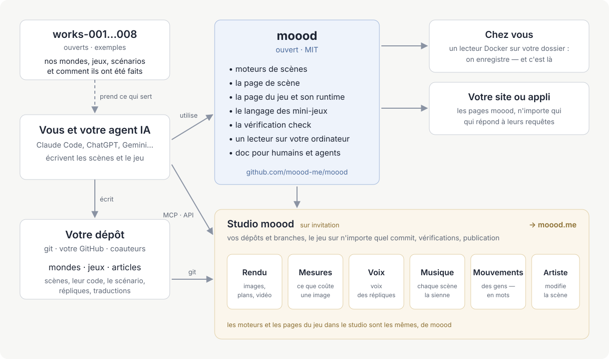

[English](README.md) · [Русский](README.ru.md) · [Українська](README.uk.md) · [Deutsch](README.de.md) · [Español](README.es.md) · [日本語](README.ja.md) · [Беларуская](README.be.md) · Français · [繁體中文](README.zh-hant.md) · [Português (Brasil)](README.pt.md) · [Polski](README.pl.md) · [한국어](README.ko.md)

# moood

[moood](https://moood.me), ce sont des mondes vivants et animés et les jeux qui s'y jouent. Un **monde** est un
ensemble de scènes — des lieux avec leur ambiance, peints en code, éclairés et en mouvement ; un **jeu** est une
histoire jouée sur un monde, écrite par son auteur sous forme de code qui lui est propre (un jeu *bespoke*) : chapitres,
choix, répliques doublées, mini-jeux.

Ce dépôt est la partie ouverte de moood : les moteurs qui font tourner les scènes, le runtime qui joue un jeu, le
langage des mini-jeux, `check` pour les textes et les traductions, un lecteur local — et la documentation de ceux qui
créent des mondes et des jeux. Écrivez les vôtres ; nous serons heureux de les voir sur moood.

Plus de détails dans l’article [« Faire son propre jeu »](https://moood.me/fr/stories/make-your-own) sur moood.me : ce que permet moood et comment le studio aide.

## Créer des mondes et des jeux

Vos mondes et vos jeux vivent dans votre propre dépôt git — autant que vous voulez, dans les dossiers que vous voulez :
un dossier avec `world.json` est un monde, avec `game.json` un jeu, avec `article.json` un article (pour le site de
moood : le lecteur local montre les mondes et les jeux). Travaillez comme vous préférez :

- **Sur votre ordinateur** — lancez le lecteur local sur votre dépôt et jouez ce que vous faites dès que vous
  l'enregistrez ([player/README.md](player/README.md)).
- **Dans le studio** — `studio.moood.me` (en construction) : votre profil, vos dépôts, des rendus, des voix, de la
  musique et des mouvements faits pour vous. Accès : demandez à [pavel-zhur](https://github.com/pavel-zhur) — completely.real@gmail.com.
- **Avec un agent IA** — Claude Code, ChatGPT, Gemini ou tout autre, sur votre machine ou dans une session cloud :
  indiquez-lui [docs/](docs/README.md) — elle est écrite autant pour les agents que pour les humains.

Pour qu'un jeu soit publié sur moood.me, demandez-le dans le studio ; il est examiné avant d'être montré.

## Modifications de moood

Demandez-les via les issues GitHub de ce dépôt (`AGENTS.md`).

## Documentation

[docs/README.md](docs/README.md) — par où commencer : les principes, le langage de la scène, les personnes et le
mouvement, comment un jeu est construit, les mini-jeux, comment écrire l'histoire d'un jeu. La plus grande partie est
en russe pour l'instant ; l'anglais viendra.

## Organisation

- `engines/1/` — moteur 1 (peintures en Canvas 2D, dessinées par three.js sur WebGL2) et la scène sur laquelle chaque page montre une scène (`stage.js` : l'un ou l'autre moteur
  derrière une seule API ; parole, musique, sous-titres, widgets, volume) ; ses pages pour les moteurs de rendu (`render.html`, `stand.html`,
  `motion.html`) ; les données des personnes que lisent les deux moteurs.
- `engines/3/` — moteur 3 (WebGPU) : une scène avec `"engine": 3` — toute nouvelle scène.
- `scene/` — la page de la scène ; `host.js` — le côté des pages dans l'échange avec l'hôte.
- `play/` — la page de la partie bespoke, son runtime (`runtime.js` : ce que reçoit le code d'un jeu) et le langage
  des mini-jeux (`minigame/`).
- `i18n/` — les langues (`languages.json`), le traducteur par lequel passe chaque texte (`i18n.js`), les mots des pages.
- `packages/check/` — `@moood/check` : un dépôt de mondes, de jeux et d'articles, vérifié.
- `player/` — le lecteur local : les mondes et les jeux d'un dossier, montrés et joués par les pages (`Dockerfile` — son image).
- `test/` — les tests (`node --test test/*.test.js`, une fois `packages/check` construit : là, `npm ci && npm run build`)
  et leur fixture ; `test/gpu/` — les programmes GPU du moteur 3 vérifiés dans node (là, `npm ci && node check.mjs`) ;
  `.github/workflows/ci.yml` — check, les tests et la vérification GPU à chaque push et pull request ; depuis `main`, l'image du lecteur, `ghcr.io/moood-me/moood-player` ; depuis un tag
  `check-v<version>`, `@moood/check` sur npm (trusted publishing de npm : le paquet fait confiance au `ci.yml` de ce dépôt ; pas de jeton).
- `docs/host.md` — ce que les pages demandent à ce qui les sert ; `docs/engine3/` — les documents propres au moteur 3
  (sa conception, ses contrats, son plan : pour qui le modifie) ; `docs/history/` — ce qui a été fait et comment.

Le studio, le site public et ce qui fabrique les voix, la musique, les images et les mouvements (l'atelier) ne sont pas
ici ; les pages les demandent à leur hôte, et un hôte qui n'en fabrique aucun — le lecteur local — prend le résultat
tout prêt dans l'atelier d'un studio, par clé (`docs/host.md` : The workshop).

## Licence

MIT (`LICENSE`). Les travaux de tiers qu'il contient gardent leur propre licence : three.js (MIT, sa notice en tête de
`engines/1/three.js`), les corps et les vêtements (`engines/1/bodies/bodies.md`), SOMA (`engines/1/soma.md`) — leurs
parties sous Apache-2.0 dans `engines/1/NOTICE`, la licence à côté (`engines/1/LICENSE-Apache-2.0.txt`) —, les sons
des mini-jeux (`play/minigame/sounds/LICENSE.md`).
