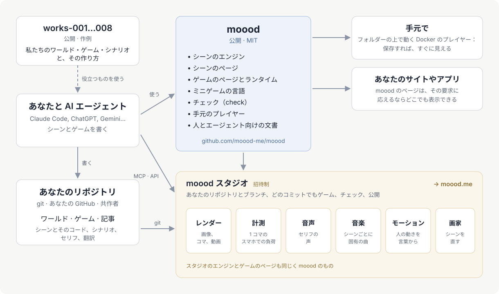

[English](README.md) · [Русский](README.ru.md) · [Українська](README.uk.md) · [Deutsch](README.de.md) · [Español](README.es.md) · 日本語 · [Беларуская](README.be.md) · [Français](README.fr.md) · [繁體中文](README.zh-hant.md) · [Português (Brasil)](README.pt.md) · [Polski](README.pl.md) · [한국어](README.ko.md)

# moood

[moood](https://moood.me) は、生きて動くアニメーションの世界と、その世界で遊ぶゲームです。**ワールド**はシーンの集まりです。
それぞれの場所が固有の雰囲気を持ち、コードで描かれ、光と動きが与えられています。**ゲーム**はワールドの上で遊ぶ物語で、
作者が自分自身のコードとして書きます（*bespoke* ゲーム）。章、選択、ボイス付きのセリフ、ミニゲームで構成されます。

このリポジトリは moood のオープンな部分です。シーンを動かすエンジン、ゲームを実行するランタイム、ミニゲームの言語、
テキストと翻訳のための `check`、ローカルプレイヤー、そしてワールドやゲームを作る人のためのドキュメントが入っています。
ぜひ自分のものを作ってください。moood で見られるのを楽しみにしています。

詳しくは moood.me の記事[「自分のゲームを作る」](https://moood.me/ja/stories/make-your-own)へ：moood でできること、スタジオが手伝えること。

## ワールドとゲームを作る

あなたのワールドとゲームは、あなた自身の git リポジトリに置きます。数もフォルダも自由です。`world.json` のあるフォルダは
ワールド、`game.json` のあるフォルダはゲーム、`article.json` のあるフォルダは記事です（moood のサイト向け。ローカルプレイヤーが
表示するのはワールドとゲームです）。好きな方法で作業してください。

- **自分のコンピューターで** — 自分のリポジトリに対してローカルプレイヤーを起動すれば、保存したそばから作っているものを
  プレイできます（[player/README.md](player/README.md)）。
- **スタジオで** — `studio.moood.me`（構築中）：あなたのプロフィール、リポジトリ、あなたのために作られるレンダー、声、音楽、
  モーション。アクセスは [pavel-zhur](https://github.com/pavel-zhur) に依頼してください — completely.real@gmail.com。
- **AI エージェントと** — Claude Code、ChatGPT、Gemini などどれでも、自分のマシンでもクラウドセッションでも構いません。
  [docs/](docs/README.md) を案内してください。ドキュメントは人間と同じくらいエージェントのために書かれています。

ゲームを moood.me に公開したいときは、スタジオで依頼してください。公開前にレビューされます。

## moood への変更

このリポジトリの GitHub issues から依頼してください（`AGENTS.md`）。

## ドキュメント

[docs/README.md](docs/README.md) — どこから始めるか：原則、シーンの言語、人とモーション、ゲームの作り方、ミニゲーム、
ゲームのストーリーの書き方。今のところ大部分はロシア語で書かれています。英語版は今後用意されます。

## 構成

- `engines/1/` — エンジン 1（Canvas 2D の絵を three.js が WebGL2 で描画）と、すべてのページがシーンを表示するステージ（`stage.js`：
  どちらのエンジンも 1 つの API の背後に置く。音声、音楽、字幕、ウィジェット、音量）。レンダラー向けのページ（`render.html`、`stand.html`、
  `motion.html`）。両方のエンジンが読む人物のデータ。
- `engines/3/` — エンジン 3（WebGPU）：`"engine": 3` を持つシーン — すべての新しいシーン。
- `scene/` — シーンのページ。`host.js` — ホストとのやり取りにおけるページ側。
- `play/` — bespoke プレイのページ、そのランタイム（`runtime.js`：ゲームのコードに渡されるもの）、ミニゲームの言語
  （`minigame/`）。
- `i18n/` — 言語（`languages.json`）、すべてのテキストが通る翻訳器（`i18n.js`）、ページの文言。
- `packages/check/` — `@moood/check`：ワールド、ゲーム、記事のリポジトリを検査します。
- `player/` — ローカルプレイヤー：フォルダ内のワールドとゲームを、ページが表示して再生します（`Dockerfile` — そのイメージ）。
- `test/` — テスト（`node --test test/*.test.js`。`packages/check` をビルドした後で。そこで `npm ci && npm run build`）とその
  フィクスチャ。`test/gpu/` — エンジン 3 の GPU プログラムを node で検査（そこで `npm ci && node check.mjs`）。
  `.github/workflows/ci.yml` — push と pull request のたびに check、テスト、GPU 検査。`main` からはプレイヤーのイメージ `ghcr.io/moood-me/moood-player`、タグ
  `check-v<version>` からは `@moood/check` を npm へ（npm の trusted publishing：パッケージがこのリポジトリの `ci.yml` を信頼する。トークンなし）。
- `docs/host.md` — ページが、それを提供する側に求めるもの。`docs/engine3/` — エンジン 3 自身のドキュメント（設計、
  コントラクト、計画：変更する人向け）。`docs/history/` — 何をどう行ったかの記録。

スタジオ、公開サイト、そして声・音楽・画像・モーションを作るもの（ワークショップ）はここにはありません。ページはそれらをホストに
求め、自分では何も作らないホスト — ローカルプレイヤー — は、スタジオのワークショップから完成品をキーで受け取ります
（`docs/host.md`：The workshop）。

## ライセンス

MIT（`LICENSE`）。中に含まれる第三者の成果物は、それぞれのライセンスのままです。three.js（MIT、その表示は
`engines/1/three.js` の冒頭）、身体と衣服（`engines/1/bodies/bodies.md`）、SOMA（`engines/1/soma.md`）— そのうち
Apache-2.0 の部分は `engines/1/NOTICE` に、ライセンスはその隣（`engines/1/LICENSE-Apache-2.0.txt`）にあります —、
ミニゲームの音（`play/minigame/sounds/LICENSE.md`）。
