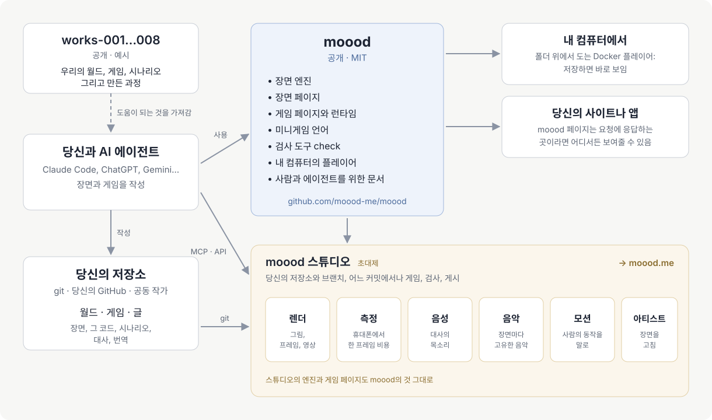

[English](README.md) · [Русский](README.ru.md) · [Українська](README.uk.md) · [Deutsch](README.de.md) · [Español](README.es.md) · [日本語](README.ja.md) · [Беларуская](README.be.md) · [Français](README.fr.md) · [繁體中文](README.zh-hant.md) · [Português (Brasil)](README.pt.md) · [Polski](README.pl.md) · 한국어

# moood

[moood](https://moood.me)는 살아 움직이는 애니메이션 세계와, 그 세계 위에서 즐기는 게임입니다. **월드**는 장면의 모음입니다.
저마다의 분위기를 지닌 장소가 코드로 그려지고, 빛과 움직임을 갖습니다. **게임**은 월드 위에서 펼쳐지는 이야기로, 작가가 자신만의
코드로 직접 씁니다(*bespoke* 게임): 챕터, 선택, 음성이 입혀진 대사, 미니게임.

이 저장소는 moood의 공개된 부분입니다. 장면을 실행하는 엔진, 게임을 구동하는 런타임, 미니게임의 언어, 텍스트와 번역을 위한
`check`, 로컬 플레이어, 그리고 월드와 게임을 만드는 사람들을 위한 문서가 들어 있습니다. 직접 만들어 보세요. moood에서
만나볼 수 있다면 기쁘겠습니다.

자세한 내용은 moood.me의 글 [「나만의 게임 만들기」](https://moood.me/ko/stories/make-your-own)에서: moood로 할 수 있는 것, 스튜디오가 돕는 것.

## 월드와 게임 만들기

여러분의 월드와 게임은 여러분 자신의 git 저장소에 있습니다. 개수도 폴더도 자유입니다. `world.json`이 있는 폴더는 월드,
`game.json`이 있는 폴더는 게임, `article.json`이 있는 폴더는 글입니다(moood 사이트용이며, 로컬 플레이어는 월드와 게임을 보여 줍니다).
편한 방식으로 작업하세요.

- **내 컴퓨터에서** — 내 저장소 위에서 로컬 플레이어를 실행하면, 저장하는 즉시 만들고 있는 것을 플레이할 수 있습니다
  ([player/README.md](player/README.md)).
- **스튜디오에서** — `studio.moood.me`(구축 중): 내 프로필, 내 저장소, 나를 위해 만들어진 렌더, 음성, 음악, 모션.
  이용 권한은 [pavel-zhur](https://github.com/pavel-zhur)에게 요청하세요 — completely.real@gmail.com.
- **AI 에이전트와 함께** — Claude Code, ChatGPT, Gemini 등 어떤 것이든, 내 컴퓨터에서나 클라우드 세션에서나 가능합니다.
  [docs/](docs/README.md)를 알려 주세요. 이 문서는 사람만큼이나 에이전트를 위해 쓰였습니다.

게임을 moood.me에 게시하려면 스튜디오에서 요청하세요. 공개되기 전에 검토를 거칩니다.

## moood 변경 요청

이 저장소의 GitHub issues를 통해 요청하세요(`AGENTS.md`).

## 문서

[docs/README.md](docs/README.md) — 어디서 시작할지: 원칙, 장면의 언어, 사람과 모션, 게임이 만들어지는 방식, 미니게임,
게임의 이야기를 쓰는 방법. 지금은 대부분 러시아어로 되어 있으며, 영어판은 준비 중입니다.

## 구성

- `engines/1/` — 엔진 1(Canvas 2D로 그린 그림을 three.js가 WebGL2로 그림)과 모든 페이지가 장면을 보여 주는 무대(`stage.js`: 두 엔진 모두
  하나의 API 뒤에 있음. 음성, 음악, 자막, 위젯, 볼륨). 렌더러용 페이지(`render.html`, `stand.html`,
  `motion.html`). 두 엔진이 모두 읽는 인물 데이터.
- `engines/3/` — 엔진 3(WebGPU): `"engine": 3`이 지정된 장면 — 모든 새 장면.
- `scene/` — 장면의 페이지. `host.js` — 호스트와의 약속에서 페이지 쪽.
- `play/` — bespoke 플레이의 페이지, 그 런타임(`runtime.js`: 게임의 코드가 받는 것), 미니게임의 언어
  (`minigame/`).
- `i18n/` — 언어(`languages.json`), 모든 텍스트가 거치는 번역기(`i18n.js`), 페이지의 문구.
- `packages/check/` — `@moood/check`: 월드, 게임, 글로 이루어진 저장소를 검사합니다.
- `player/` — 로컬 플레이어: 폴더의 월드와 게임을 페이지가 보여 주고 실행합니다(`Dockerfile` — 그 이미지).
- `test/` — 테스트(`node --test test/*.test.js`, `packages/check`을 빌드한 뒤: 거기서 `npm ci && npm run build`)와 그
  픽스처. `test/gpu/` — 엔진 3의 GPU 프로그램을 node에서 검사(거기서 `npm ci && node check.mjs`).
  `.github/workflows/ci.yml` — 매 push와 pull request마다 check, 테스트, GPU 검사. `main`에서는 플레이어 이미지 `ghcr.io/moood-me/moood-player`, 태그
  `check-v<version>`에서는 `@moood/check`를 npm으로(npm의 trusted publishing: 패키지가 이 저장소의 `ci.yml`을 신뢰함. 토큰 없음).
- `docs/host.md` — 페이지가 그것을 제공하는 쪽에 요구하는 것. `docs/engine3/` — 엔진 3 자체의 문서(설계,
  계약, 계획: 그것을 수정하는 사람을 위한 것). `docs/history/` — 무엇을 어떻게 했는지의 기록.

스튜디오, 공개 사이트, 그리고 음성·음악·그림·모션을 만드는 것(워크숍)은 여기에 없습니다. 페이지는 이것들을 호스트에 요청하고,
스스로 만들지 않는 호스트 — 로컬 플레이어 — 는 스튜디오의 워크숍에서 완성된 것을 키로 받아 옵니다
(`docs/host.md`: The workshop).

## 라이선스

MIT(`LICENSE`). 안에 포함된 제3자의 작업물은 각자의 라이선스를 유지합니다. three.js(MIT, 그 고지는
`engines/1/three.js` 맨 앞), 몸과 의상(`engines/1/bodies/bodies.md`), SOMA(`engines/1/soma.md`) — 이 중
Apache-2.0 부분은 `engines/1/NOTICE`에, 라이선스 본문은 그 옆(`engines/1/LICENSE-Apache-2.0.txt`)에 있습니다 —,
미니게임의 소리(`play/minigame/sounds/LICENSE.md`).
