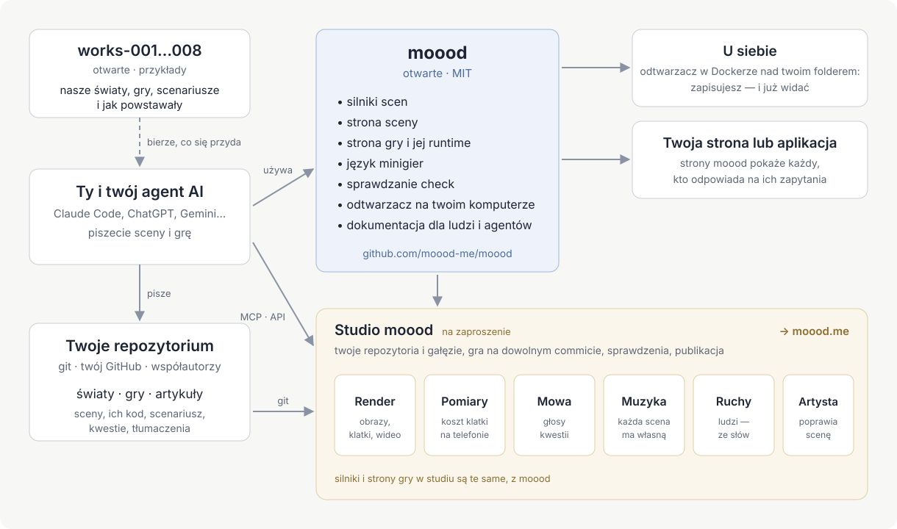

[English](README.md) · [Русский](README.ru.md) · [Українська](README.uk.md) · [Deutsch](README.de.md) · [Español](README.es.md) · [日本語](README.ja.md) · [Беларуская](README.be.md) · [Français](README.fr.md) · [繁體中文](README.zh-hant.md) · [Português (Brasil)](README.pt.md) · Polski · [한국어](README.ko.md)

# moood

[moood](https://moood.me) to żywe, animowane światy i gry, w które się w nich gra. **Świat** to zbiór scen — miejsc ze
swoim nastrojem, namalowanych kodem, oświetlonych i w ruchu; **gra** to historia rozgrywana w świecie, którą autor pisze
jako własny kod (gra *bespoke*): rozdziały, wybory, udźwiękowione kwestie, minigry.

To repozytorium jest otwartą częścią moood: silniki, które uruchamiają sceny, runtime, który odtwarza grę, język minigier,
`check` do tekstów i tłumaczeń, lokalny odtwarzacz — oraz dokumentacja dla tych, którzy tworzą światy i gry. Pisz własne;
chętnie zobaczymy je na moood.

Więcej w artykule [„Zrób własną grę”](https://moood.me/pl/stories/make-your-own) na moood.me: co daje moood i jak pomaga studio.

## Tworzenie światów i gier

Twoje światy i gry żyją w twoim własnym repozytorium git — w dowolnej liczbie i w dowolnych folderach: folder z
`world.json` to świat, z `game.json` — gra, z `article.json` — artykuł (dla strony moood: lokalny odtwarzacz pokazuje
światy i gry). Pracuj, jak ci wygodnie:

- **Na swoim komputerze** — uruchom lokalny odtwarzacz nad swoim repozytorium i graj w to, co tworzysz, od razu po
  zapisaniu ([player/README.md](player/README.md)).
- **W studiu** — `studio.moood.me` (w budowie): twój profil, twoje repozytoria, rendery, głosy, muzyka i ruchy
  zrobione dla ciebie. Dostęp: poproś [pavel-zhur](https://github.com/pavel-zhur) — completely.real@gmail.com.
- **Z agentem AI** — Claude Code, ChatGPT, Gemini lub dowolnym innym, na swojej maszynie albo w sesji w chmurze:
  wskaż mu [docs/](docs/README.md) — dokumentacja jest pisana tak samo dla agentów, jak dla ludzi.

Żeby gra pojawiła się na moood.me, poproś o to w studiu; przed pokazaniem jest sprawdzana.

## Zmiany w moood

Zgłaszaj je przez GitHub issues w tym repozytorium (`AGENTS.md`).

## Dokumentacja

[docs/README.md](docs/README.md) — od czego zacząć: zasady, język sceny, ludzie i ruch, jak zbudowana jest gra,
minigry, jak pisać historię gry. Na razie większość jest po rosyjsku; angielski dopiero będzie.

## Układ

- `engines/1/` — silnik 1 (obrazy w Canvas 2D, rysowane przez three.js na WebGL2) i scena, na której każda strona pokazuje scenę (`stage.js`: każdy z dwóch silników
  za jednym API; mowa, muzyka, napisy, widżety, głośność); jego strony dla rendererów (`render.html`, `stand.html`,
  `motion.html`); dane ludzi, które czytają oba silniki.
- `engines/3/` — silnik 3 (WebGPU): scena z `"engine": 3` — każda nowa scena.
- `scene/` — strona sceny; `host.js` — strona stron w kontakcie z hostem.
- `play/` — strona rozgrywki bespoke, jej runtime (`runtime.js`: co dostaje kod gry) i język minigier
  (`minigame/`).
- `i18n/` — języki (`languages.json`), tłumacz, przez którego przechodzi każdy tekst (`i18n.js`), słowa stron.
- `packages/check/` — `@moood/check`: sprawdzone repozytorium światów, gier i artykułów.
- `player/` — lokalny odtwarzacz: światy i gry z folderu, pokazywane i odgrywane przez strony (`Dockerfile` — jego obraz).
- `test/` — testy (`node --test test/*.test.js`, gdy `packages/check` jest zbudowane: tam `npm ci && npm run build`)
  i ich fixture; `test/gpu/` — programy GPU silnika 3 sprawdzane w node (tam `npm ci && node check.mjs`);
  `.github/workflows/ci.yml` — check, testy i sprawdzenie GPU przy każdym push i pull request; z `main` obraz odtwarzacza, `ghcr.io/moood-me/moood-player`; z tagu
  `check-v<version>` `@moood/check` na npm (trusted publishing npm: pakiet ufa `ci.yml` tego repozytorium; bez tokena).
- `docs/host.md` — czego strony wymagają od tego, kto je serwuje; `docs/engine3/` — własne dokumenty silnika 3 (jego
  projekt, kontrakty, plan: dla tego, kto go zmienia); `docs/history/` — co zrobiono i jak.

Studia, strony publicznej i tego, co tworzy głosy, muzykę, obrazy i ruchy (warsztatu), tu nie ma; strony proszą o to
swojego hosta, a host, który niczego z tego nie tworzy — lokalny odtwarzacz — bierze gotowe rzeczy z warsztatu studia
po kluczu (`docs/host.md`: The workshop).

## Licencja

MIT (`LICENSE`). Cudze prace wewnątrz zachowują własne licencje: three.js (MIT, jego nota na początku
`engines/1/three.js`), ciała i ubrania (`engines/1/bodies/bodies.md`), SOMA (`engines/1/soma.md`) — ich części na
Apache-2.0 w `engines/1/NOTICE`, licencja obok (`engines/1/LICENSE-Apache-2.0.txt`) —, dźwięki minigier
(`play/minigame/sounds/LICENSE.md`).
