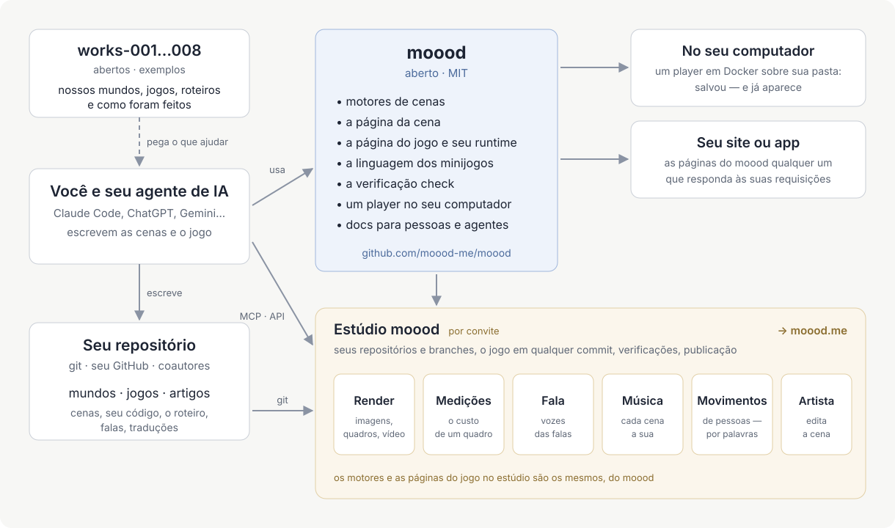

[English](README.md) · [Русский](README.ru.md) · [Українська](README.uk.md) · [Deutsch](README.de.md) · [Español](README.es.md) · [日本語](README.ja.md) · [Беларуская](README.be.md) · [Français](README.fr.md) · [繁體中文](README.zh-hant.md) · Português (Brasil) · [Polski](README.pl.md) · [한국어](README.ko.md)

# moood

[moood](https://moood.me) são mundos vivos e animados e os jogos que se jogam neles. Um **mundo** é um conjunto de
cenas — lugares com o seu clima, pintados em código, iluminados e em movimento; um **jogo** é uma história jogada em um
mundo, escrita pelo autor como código próprio (um jogo *bespoke*): capítulos, escolhas, falas dubladas, minijogos.

Este repositório é a parte aberta do moood: os motores que executam as cenas, o runtime que roda um jogo, a linguagem
dos minijogos, o `check` para textos e traduções, um player local — e a documentação para quem cria mundos e jogos.
Escreva os seus; vamos adorar vê-los no moood.

Mais no artigo [«Faça seu próprio jogo»](https://moood.me/pt/stories/make-your-own) no moood.me: o que o moood permite e como o estúdio ajuda.

## Criando mundos e jogos

Os seus mundos e jogos ficam no seu próprio repositório git — quantos você quiser, nas pastas que quiser: uma pasta com
`world.json` é um mundo, com `game.json` um jogo, com `article.json` um artigo (para o site do moood: o player local
mostra mundos e jogos). Trabalhe do jeito que preferir:

- **No seu computador** — rode o player local sobre o seu repositório e jogue o que você faz assim que salvar
  ([player/README.md](player/README.md)).
- **No estúdio** — `studio.moood.me` (em construção): o seu perfil, os seus repositórios, renders, vozes, música e
  movimentos feitos para você. Acesso: peça ao [pavel-zhur](https://github.com/pavel-zhur) — completely.real@gmail.com.
- **Com um agente de IA** — Claude Code, ChatGPT, Gemini ou qualquer outro, na sua máquina ou em uma sessão na nuvem:
  aponte-o para [docs/](docs/README.md) — ela foi escrita tanto para agentes quanto para pessoas.

Para ter um jogo publicado no moood.me, peça no estúdio; ele é revisado antes de ser exibido.

## Mudanças no moood

Peça pelas issues do GitHub deste repositório (`AGENTS.md`).

## Documentação

[docs/README.md](docs/README.md) — por onde começar: princípios, a linguagem da cena, pessoas e movimento, como um jogo
é construído, minijogos, como escrever a história de um jogo. A maior parte está em russo por enquanto; o inglês vem
aí.

## Estrutura

- `engines/1/` — motor 1 (pinturas em Canvas 2D, desenhadas pelo three.js sobre WebGL2) e o palco em que cada página mostra uma cena (`stage.js`: qualquer um dos motores
  por trás de uma única API; fala, música, legendas, widgets, volume); as suas páginas para renderizadores (`render.html`, `stand.html`,
  `motion.html`); os dados das pessoas que ambos os motores leem.
- `engines/3/` — motor 3 (WebGPU): uma cena com `"engine": 3` — toda cena nova.
- `scene/` — a página da cena; `host.js` — o lado das páginas na conversa com o host.
- `play/` — a página da partida bespoke, o seu runtime (`runtime.js`: o que o código de um jogo recebe) e a linguagem
  dos minijogos (`minigame/`).
- `i18n/` — os idiomas (`languages.json`), o tradutor por onde passa todo texto (`i18n.js`), as palavras das páginas.
- `packages/check/` — `@moood/check`: um repositório de mundos, jogos e artigos, verificado.
- `player/` — o player local: os mundos e jogos de uma pasta, mostrados e jogados pelas páginas (`Dockerfile` — a sua imagem).
- `test/` — os testes (`node --test test/*.test.js`, depois que `packages/check` estiver compilado: lá, `npm ci && npm run build`)
  e a sua fixture; `test/gpu/` — os programas de GPU do motor 3 verificados no node (lá, `npm ci && node check.mjs`);
  `.github/workflows/ci.yml` — check, os testes e a verificação de GPU a cada push e pull request; a partir de `main`, a imagem do player, `ghcr.io/moood-me/moood-player`; a partir de uma tag
  `check-v<version>`, o `@moood/check` no npm (trusted publishing do npm: o pacote confia no `ci.yml` deste repositório; sem token).
- `docs/host.md` — o que as páginas pedem a quem as serve; `docs/engine3/` — os documentos próprios do motor 3 (o seu
  projeto, contratos, plano: para quem o altera); `docs/history/` — o que foi feito e como.

O estúdio, o site público e o que faz as vozes, a música, as imagens e os movimentos (a oficina) não estão aqui; as
páginas pedem isso ao seu host, e um host que não faz nada disso — o player local — pega o que já está pronto na oficina
de um estúdio, por chave (`docs/host.md`: The workshop).

## Licença

MIT (`LICENSE`). O trabalho de terceiros incluído mantém a sua própria licença: three.js (MIT, o aviso dele no início de
`engines/1/three.js`), os corpos e as roupas (`engines/1/bodies/bodies.md`), SOMA (`engines/1/soma.md`) — as partes
deles sob Apache-2.0 em `engines/1/NOTICE`, a licença ao lado (`engines/1/LICENSE-Apache-2.0.txt`) —, os sons dos
minijogos (`play/minigame/sounds/LICENSE.md`).
