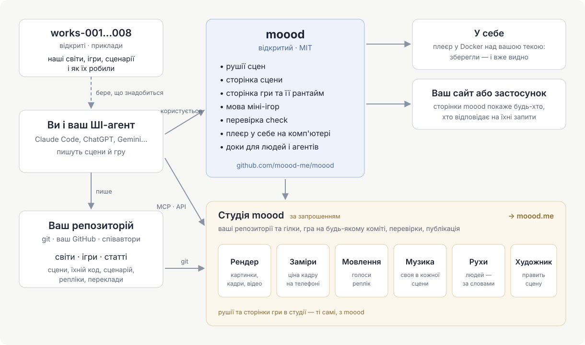

[English](README.md) · [Русский](README.ru.md) · Українська · [Deutsch](README.de.md) · [Español](README.es.md) · [日本語](README.ja.md) · [Беларуская](README.be.md) · [Français](README.fr.md) · [繁體中文](README.zh-hant.md) · [Português (Brasil)](README.pt.md) · [Polski](README.pl.md) · [한국어](README.ko.md)

# moood

[moood](https://moood.me) — це живі анімовані світи та ігри, в які на них грають. **Світ** — набір сцен: місць зі своїм
настроєм, намальованих кодом, зі світлом і рухом; **гра** — історія, що розгортається у світі, яку автор пише власним
кодом (гра *bespoke*): розділи, вибори, озвучені репліки, міні-ігри.

Це відкрита частина moood: рушії, що запускають сцени, рантайм, що відтворює гру, мова міні-ігор, `check` для текстів і
перекладів, локальний програвач — і документація для тих, хто створює світи й ігри. Пишіть власні; ми будемо раді
побачити їх на moood.

Докладніше — у статті [«Зробити свою гру»](https://moood.me/uk/stories/make-your-own) на moood.me: що дає moood і чим допомагає студія.

## Створення світів і ігор

Ваші світи та ігри живуть у вашому власному git-репозиторії — у будь-якій кількості й у будь-яких теках: тека з
`world.json` — це світ, з `game.json` — гра, з `article.json` — стаття (для сайту moood: локальний програвач показує
світи й ігри). Працюйте так, як вам зручно:

- **На своєму комп'ютері** — запустіть локальний програвач над своїм репозиторієм і грайте в те, що створюєте, одразу
  після збереження ([player/README.md](player/README.md)).
- **У студії** — `studio.moood.me` (будується): ваш профіль, ваші репозиторії, рендери, голоси, музика та рухи, зроблені
  для вас. Доступ: попросіть [pavel-zhur](https://github.com/pavel-zhur) — completely.real@gmail.com.
- **З ШІ-агентом** — Claude Code, ChatGPT, Gemini чи будь-яким іншим, на вашій машині або в хмарній сесії: вкажіть
  йому на [docs/](docs/README.md) — вони написані як для агентів, так і для людей.

Щоб гру опублікували на moood.me, попросіть у студії; перед показом її перевіряють.

## Зміни в moood

Просіть через GitHub issues у цьому репозиторії (`AGENTS.md`).

## Документація

[docs/README.md](docs/README.md) — з чого почати: принципи, мова сцени, люди та рух, як будується гра, міні-ігри, як
писати історію гри. Більша частина поки що російською; англійська буде.

## Структура

- `engines/1/` — рушій 1 (картини на Canvas 2D, малює three.js на WebGL2) і сцена, на якій кожна сторінка показує сцену (`stage.js`: будь-який рушій
  за єдиним API; мовлення, музика, підписи, віджети, гучність); його сторінки для рендерерів (`render.html`, `stand.html`,
  `motion.html`); дані про людей, які читають обидва рушії.
- `engines/3/` — рушій 3 (WebGPU): сцена з `"engine": 3` — кожна нова сцена.
- `scene/` — сторінка сцени; `host.js` — сторона сторінок у взаємодії з хостом.
- `play/` — сторінка bespoke-партії, її рантайм (`runtime.js`: що отримує код гри) і мова міні-ігор
  (`minigame/`).
- `i18n/` — мови (`languages.json`), перекладач, через який проходить кожен текст (`i18n.js`), слова сторінок.
- `packages/check/` — `@moood/check`: перевірка репозиторію світів, ігор і статей.
- `player/` — локальний програвач: світи та ігри теки, показані й відтворені сторінками (`Dockerfile` — його образ).
- `test/` — тести (`node --test test/*.test.js`, коли зібрано `packages/check`: там `npm ci && npm run build`)
  і їхня фікстура; `test/gpu/` — перевірка GPU-програм рушія 3 у node (там `npm ci && node check.mjs`);
  `.github/workflows/ci.yml` — check, тести та перевірка GPU на кожен push і pull request; із `main` — образ програвача, `ghcr.io/moood-me/moood-player`; з тега
  `check-v<version>` — `@moood/check` у npm (trusted publishing від npm: пакет довіряє `ci.yml` цього репозиторію; без токена).
- `docs/host.md` — чого сторінки потребують від того, хто їх обслуговує; `docs/engine3/` — власні документи рушія 3 (його
  устрій, контракти, план: для тих, хто його змінює); `docs/history/` — що зроблено і як.

Студії, публічного сайту й того, що створює голоси, музику, зображення та рухи (майстерні), тут немає; сторінки
запитують це в свого хоста, а хост, який нічого з цього не створює, — локальний програвач — бере готове з майстерні
студії за ключем (`docs/host.md`: The workshop).

## Ліцензія

MIT (`LICENSE`). Сторонні матеріали всередині зберігають власні ліцензії: three.js (MIT, його повідомлення на початку
`engines/1/three.js`), тіла й одяг (`engines/1/bodies/bodies.md`), SOMA (`engines/1/soma.md`) — частини під
Apache-2.0 серед них описані в `engines/1/NOTICE`, текст ліцензії поруч (`engines/1/LICENSE-Apache-2.0.txt`) —,
звуки міні-ігор (`play/minigame/sounds/LICENSE.md`).
