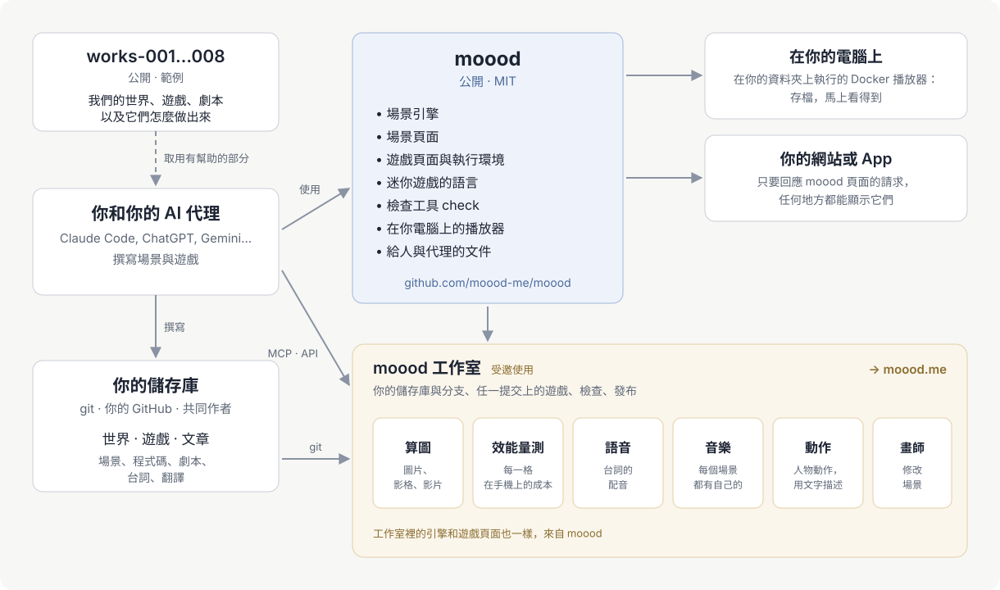

[English](README.md) · [Русский](README.ru.md) · [Українська](README.uk.md) · [Deutsch](README.de.md) · [Español](README.es.md) · [日本語](README.ja.md) · [Беларуская](README.be.md) · [Français](README.fr.md) · 繁體中文 · [Português (Brasil)](README.pt.md) · [Polski](README.pl.md) · [한국어](README.ko.md)

# moood

[moood](https://moood.me) 是活生生的動畫世界，以及在這些世界上玩的遊戲。**世界**是一組場景——每個地方都有自己的氛圍，
以程式碼繪成，有光影，也會動；**遊戲**是在世界上進行的故事，由作者以自己的程式碼寫成（*bespoke* 遊戲）：章節、選擇、
有配音的台詞、小遊戲。

這個儲存庫是 moood 開放的部分：執行場景的引擎、執行遊戲的執行環境（runtime）、小遊戲的語言、用於文字與翻譯的 `check`、
本機播放器——還有給創作世界與遊戲的人看的文件。寫出你自己的吧；我們很樂意在 moood 上看到它們。

更多內容請見 moood.me 上的文章[〈做你自己的遊戲〉](https://moood.me/zh-hant/stories/make-your-own)：moood 能做什麼，工作室能幫上什麼忙。

## 創作世界與遊戲

你的世界與遊戲放在你自己的 git 儲存庫裡——數量不限，放在哪個資料夾都行：含有 `world.json` 的資料夾是世界，含有
`game.json` 的是遊戲，含有 `article.json` 的是文章（供 moood 網站使用：本機播放器顯示世界與遊戲）。用你喜歡的方式工作：

- **在你的電腦上** — 在你的儲存庫上啟動本機播放器，儲存後就能立刻玩到你正在做的內容
  （[player/README.md](player/README.md)）。
- **在工作室** — `studio.moood.me`（建置中）：你的個人檔案、你的儲存庫，以及為你製作的渲染、聲音、音樂與動作。
  使用權限：請洽 [pavel-zhur](https://github.com/pavel-zhur) — completely.real@gmail.com。
- **與 AI 代理** — Claude Code、ChatGPT、Gemini 或任何其他代理，在你的機器上或雲端工作階段中皆可：請它閱讀
  [docs/](docs/README.md) — 這份文件是為代理寫的，不亞於為人寫的。

若要讓遊戲發布在 moood.me，請在工作室中提出；展示之前會先經過審核。

## 對 moood 的修改

請透過這個儲存庫的 GitHub issues 提出（`AGENTS.md`）。

## 文件

[docs/README.md](docs/README.md) — 從哪裡開始：原則、場景的語言、人物與動作、遊戲如何建構、小遊戲、如何撰寫遊戲的故事。
目前大部分是俄文；英文版即將推出。

## 目錄結構

- `engines/1/` — 引擎 1（以 Canvas 2D 繪製畫面，由 three.js 在 WebGL2 上繪出）以及每個頁面用來顯示場景的舞台（`stage.js`：
  兩種引擎共用同一個 API；語音、音樂、字幕、小工具、音量）；其供渲染器使用的頁面（`render.html`、`stand.html`、
  `motion.html`）；兩種引擎都會讀取的人物資料。
- `engines/3/` — 引擎 3（WebGPU）：帶有 `"engine": 3` 的場景——所有新場景。
- `scene/` — 場景的頁面；`host.js` — 頁面端與主機（host）溝通的部分。
- `play/` — bespoke 遊玩的頁面、其執行環境（`runtime.js`：交給遊戲程式碼的內容）以及小遊戲的語言
  （`minigame/`）。
- `i18n/` — 各種語言（`languages.json`）、每段文字都會經過的翻譯器（`i18n.js`）、頁面的文字。
- `packages/check/` — `@moood/check`：檢查由世界、遊戲與文章組成的儲存庫。
- `player/` — 本機播放器：資料夾中的世界與遊戲，由頁面顯示並遊玩（`Dockerfile` — 其映像檔）。
- `test/` — 測試（`node --test test/*.test.js`，在 `packages/check` 建置完成後：在該處執行 `npm ci && npm run build`）及其
  fixture；`test/gpu/` — 在 node 中檢查引擎 3 的 GPU 程式（在該處執行 `npm ci && node check.mjs`）；
  `.github/workflows/ci.yml` — 每次 push 與 pull request 都執行 check、測試與 GPU 檢查；從 `main` 產出播放器映像檔 `ghcr.io/moood-me/moood-player`；從標籤
  `check-v<version>` 將 `@moood/check` 發布到 npm（npm 的 trusted publishing：套件信任這個儲存庫的 `ci.yml`；沒有 token）。
- `docs/host.md` — 頁面向提供它們的一方提出的需求；`docs/engine3/` — 引擎 3 自己的文件（其設計、
  契約、計畫：給修改它的人）；`docs/history/` — 做了什麼以及如何做。

工作室、公開網站，以及製作聲音、音樂、圖片與動作的部分（工坊）不在這裡；頁面向它們的主機索取這些內容，而自己不製作的主機——
本機播放器——則憑金鑰從工作室的工坊取得現成的成品（`docs/host.md`：The workshop）。

## 授權

MIT（`LICENSE`）。其中包含的第三方作品保留各自的授權：three.js（MIT，其聲明位於
`engines/1/three.js` 開頭）、身體與服裝（`engines/1/bodies/bodies.md`）、SOMA（`engines/1/soma.md`）——其中
Apache-2.0 的部分見 `engines/1/NOTICE`，授權條文在旁邊（`engines/1/LICENSE-Apache-2.0.txt`）——、
小遊戲的音效（`play/minigame/sounds/LICENSE.md`）。
